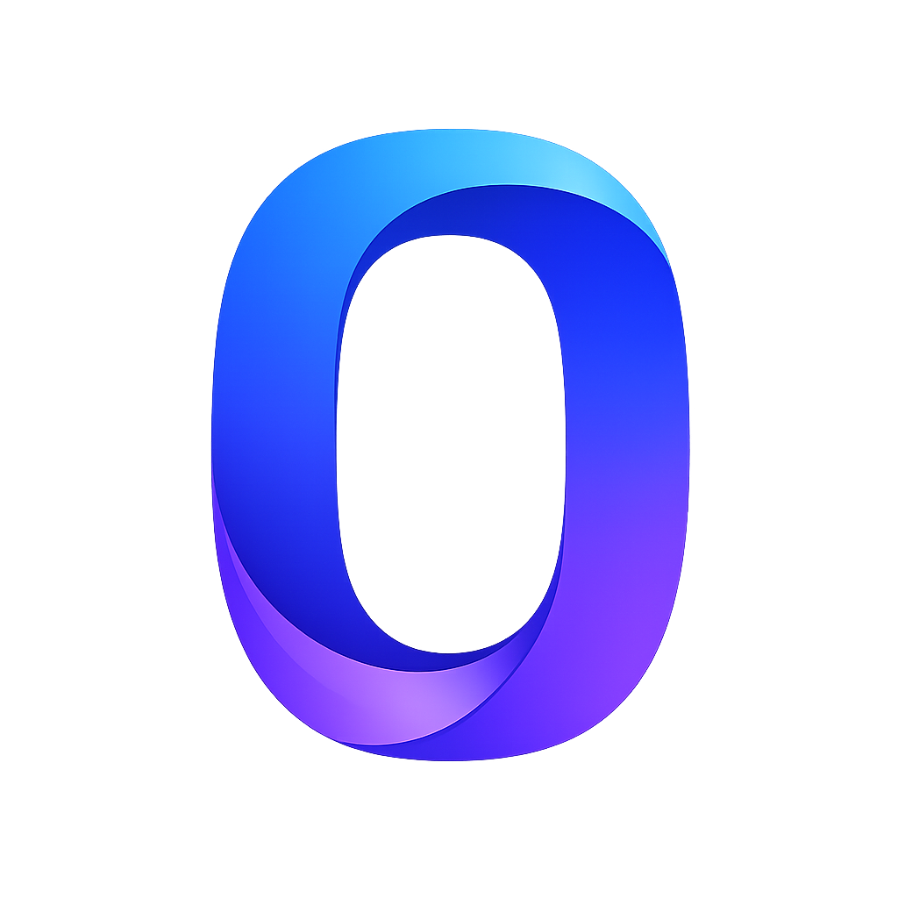

  

<h1 align="center">ZYR0</h1>

  <strong>Think. Build. Scale to ∞.</strong>

  
  
  
  
  
  

---

## Overview

**ZYR0** is a multi-product AI and SaaS ecosystem built for engineers, educators, and researchers. It is a unified platform where you can build full-stack applications with autonomous AI, run school institutions, conduct deep research at scale, and earn cryptographically verified work credentials — all from a single account.

ZYR0 is architected on standard primitives, auditable execution traces, and unconditional data portability. No proprietary lock-in. If you ever leave, your systems continue to run uninterrupted.

> **Build · Learn · Research · Work**

---

## The Products

### ZYR0 Studio — AI Builder · Instant Edge Deploy
A full-stack development environment powered by autonomous AI agents. Describe what you want to build, and Studio designs, implements, tests, and deploys it to the edge. Built for engineers who want to move from idea to production without scaffolding or boilerplate.

### School OS — Institution SaaS · Live Telemetry
A complete institution management platform for modern schools, bootcamps, and educational organizations. Manage cohorts, mentors, internship programs, certificates, and live performance telemetry from a single admin console.

### Research Agent — Autonomous AI · 140+ Sources
An autonomous deep-research engine that synthesizes information across 140+ live sources, generates structured reports, and surfaces cited insights on demand. Built for researchers, analysts, and teams that need comprehensive answers fast.

### ZYR0 Work — Proof of Work · ECDSA Verified
A career platform that connects students and engineers to real project-based work, tracks contribution, and issues cryptographically signed (ECDSA) digital certificates. Credentials are publicly verifiable and permanently portable.

### Skills Hub — 240+ Modules · Open Ecosystem
A community-driven marketplace of AI agent skills and developer tools. Browse, install, and contribute capabilities that extend the ZYR0 platform and any compatible AI coding agent.

### Developer Engine — CLI & REST · Cloud Edge
A REST API and CLI layer exposing the full ZYR0 platform surface to external applications. Build integrations, automate workflows, and deploy to the cloud edge without touching the UI.

---

## Foundational Pillars

ZYR0 is built on four architectural commitments:

1. **Sovereignty** — Standard primitives only. No proprietary runtimes, no captive formats. Your data and logic are always yours.
2. **Auditability** — Every agent action, state change, and credential issuance produces an auditable trace. Nothing happens silently.
3. **Portability** — Export, migrate, or self-host at any time. ZYR0 systems continue to run uninterrupted after departure.
4. **Verifiability** — Credentials and work records are ECDSA-signed and publicly verifiable at a permanent endpoint, without calling home.

---

## Tech Stack

### Frontend Architecture
- **Framework**: [React 19](https://react.dev/) + [Vite 7](https://vitejs.dev/)
- **Routing**: [React Router v7](https://reactrouter.com/)
- **Language**: [TypeScript 5.9](https://www.typescriptlang.org/) (Strict Mode)
- **Styling**: [Tailwind CSS 3.4](https://tailwindcss.com/) + Custom CSS Design Tokens
- **UI & Motion**: [Radix UI](https://www.radix-ui.com/), [Lucide Icons](https://lucide.dev/), and [Framer Motion](https://www.framer.com/motion/)
- **Canvas & WebGL**: Custom WebGL2 interactive surfaces, HTML5 Canvas particle systems, and 3D line-art cycling renderers

### Backend & Infrastructure
- **Platform**: [Supabase](https://supabase.com/) (PostgreSQL with Row-Level Security)
- **Authentication**: Supabase Auth — JWT, RBAC, and ECDSA credential signing
- **Storage**: Supabase Storage for assets, avatars, resumes, and generated documents
- **Hosting & Edge**: [Vercel](https://vercel.com/) + Supabase Edge Functions

### Quality & Tooling
- **Build System**: Vite + TypeScript Compiler (`tsc`)
- **Linting**: ESLint 9 + PostCSS + Tailwind Animate
- **SEO Engine**: Pre-rendering script generating static pages, JSON-LD schemas, `sitemap.xml`, `robots.txt`, and `llms.txt`
- **Code Splitting**: Per-route lazy loading with sub-15 kB initial bundles on public routes

---

## Getting Access

ZYR0 is a **proprietary product** and is **not open source**. This repository is published for visibility and evaluation by approved partners only. Setup, build, and deployment instructions are intentionally not published.

To request a demo, a partnership, or an invitation to collaborate:

- **Website**: [zyroo.org](https://zyroo.org)
- **Email**: [support@zyroo.org](mailto:support@zyroo.org)
- **Partnerships**: [partnerships@zyroo.org](mailto:partnerships@zyroo.org)
- **LinkedIn**: [ZYR0 Company Profile](https://linkedin.com/company/zyr0-co)
- **WhatsApp**: [ZYR0 Channel](https://whatsapp.com/channel/0029Vb8m3OK5Ui2W8xNLgy0F)

Access to environment configuration, database schema migrations, and the deployment pipeline is granted only to approved collaborators under the terms of the [LICENSE](./LICENSE).

---

## Documentation

For technical details, architectural blueprints, and engineering standards, see the [`/docs`](./docs) directory:

- **[Product Vision](./docs/PRODUCT_VISION.md)** — Core mission, platform pillars, and roadmap.
- **[Architecture Guide](./docs/ARCHITECTURE.md)** — System design, database patterns, and service boundaries.
- **[Engineering Principles](./docs/ENGINEERING_PRINCIPLES.md)** — Code quality, type safety, and performance standards.
- **[Optimistic Updates](./docs/OPTIMISTIC_UPDATES.md)** — Frontend state synchronization and caching strategy.
- **[Request Deduplication](./docs/REQUEST_DEDUPLICATION.md)** — API deduplication registry and performance optimization.
- **[Stale-While-Revalidate Caching](./docs/STALE_WHILE_REVALIDATE.md)** — SWR caching patterns and cache invalidation.
- **[Feature Status](./docs/FEATURE_STATUS.md)** — Implementation status of all platform features.
- **[Git Workflow](./docs/GIT_WORKFLOW.md)** — Branching model, commit conventions, and PR policies.
- **[Security Policy](./SECURITY.md)** — Vulnerability reporting and row-level security implementation.
- **[Changelog](./CHANGELOG.md)** — Full release history and feature notes.

---

## Contributing

ZYR0 is developed by the core team and approved collaborators. **External contributions are not accepted** for the main repository under the project's proprietary license.

Approved contributors should review **[CONTRIBUTING.md](./CONTRIBUTING.md)** before opening a pull request.

Interested in collaborating? See [Getting Access](#getting-access).

---

## Security

If you discover a vulnerability, report it privately per **[SECURITY.md](./SECURITY.md)** — not as a public issue.

---

## License

Proprietary software. All rights reserved. See **[LICENSE](./LICENSE)** for full terms. Third-party open-source libraries remain under their respective licenses.

---

## Acknowledgements

ZYR0 is built on the shoulders of open-source communities — React, Vite, Supabase, Tailwind CSS, Radix UI, Lucide, Framer Motion, and TypeScript. Sincere thanks to every maintainer whose work makes this platform possible.

---

## From the Core Team

> ZYR0 was built on a single conviction: **the tools you use to build and learn should not hold your work hostage.** Sovereignty, auditability, and portability are not features — they are the foundation. Everything else is built on top of that.

We are grateful to every engineer, educator, and researcher who builds with ZYR0.
